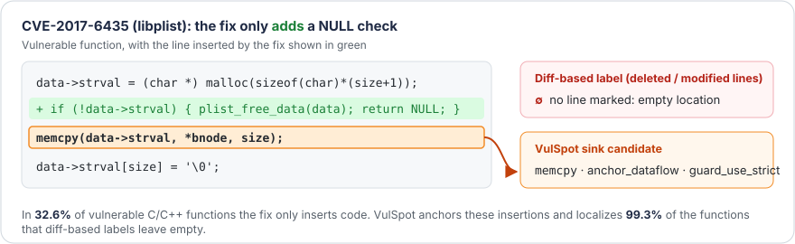
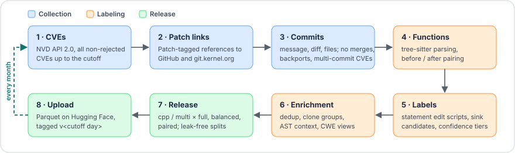

<div align="center">

<picture>
  <source media="(prefers-color-scheme: dark)" srcset="assets/logo-dark.svg">
  
</picture>

### Beyond the Diff: A Vulnerability Dataset Where No Vulnerability Goes Unlocalized

**A living benchmark for vulnerability _detection_, _CWE classification_, and _statement-level localization_.**

[](https://huggingface.co/datasets/ods01/VulSpot)
[](https://huggingface.co/datasets/ods01/VulSpot/tree/v2026-10-12)
[](#-monthly-updates)
[](#-dataset-at-a-glance)
[](requirements.txt)

[**Dataset**](https://huggingface.co/datasets/ods01/VulSpot) ·
[**Quick start**](#-quick-start) ·
[**Data format**](#-data-format) ·
[**Reproduce**](#%EF%B8%8F-reproducing-the-dataset) ·
[**Citation**](#-citation)

</div>

<p align="center">
  
</p>

## 📌 Overview

Most real-world vulnerability datasets link CVEs to their fixing commits and treat the **lines deleted or modified by the fix** as vulnerable. When a fix **only adds code**, such as a missing NULL check, a missing `free`, or a missing lock, there is no such line, so the vulnerable function has **no location**. These additive fixes are the usual root cause of some of the most frequent C/C++ weaknesses.

**VulSpot** links the code added by a patch to the existing statement it protects, and comes with labels that state how reliable they are, leak-free splits, and a monthly refresh:

| | |
|---|---|
| 🎯 **Additive fixes localized** | *Sink candidates* anchor each group of inserted statements on the statement of the vulnerable version it is tied to by data flow. They localize **99.3%** of the functions that diff-based labels leave empty. |
| 🏷️ **Reliability-aware labels** | Instead of a hard filter, each vulnerable label has a **confidence tier** and each negative has a **provenance type**. Both are computed by rules, without LLMs. |
| 🧱 **Leakage-aware evaluation** | **Clone-aware** chronological and project-holdout splits, plus high-confidence, paired, and non-Linux test subsets. Under a random row split, 57% of vulnerable test functions have a near-duplicate in training. Under VulSpot's splits, none do. |
| 🐧 **Control of the Linux shift** | A `balanced` variant caps the post-2024 kernel CVEs that would otherwise make up 75% of the C/C++ positives. |
| 🧭 **Richer annotations** | Deterministic AST-retrieved context (callees, types, macros, globals) and four hierarchical **CWE views** (CWE-1000, -1003, -699, -1400). |
| 🔄 **Living dataset** | A resumable pipeline rebuilds and republishes VulSpot **every month**. Each release adds vulnerabilities disclosed after current models' training cutoffs. |

## 📊 Dataset at a glance

Paper reference release **`v2026-10-12`** (CVEs published through 2026-10-12):

| | `cpp` / `full` | `multi` / `full` |
|---|---:|---:|
| Functions | 283,361 | 503,332 |
| Vulnerable functions | 15,932 | 28,334 |
| CVEs | 16,176 | 24,257 |
| Repositories | 753 | 3,634 |
| Distinct CWEs | 231 | 429 |
| Languages | C, C++ | 21 |
| Vulnerable functions with an additive fix | 32.6% | 25.4% |

`multi` covers C, C++, PHP, Python, JavaScript, TypeScript, Go, Java, Ruby, Rust, C#, Erlang, Perl, Swift, Kotlin, Objective-C, Scala, Bash, Lua, Dart, and TSX.

<details>
<summary><b>How VulSpot compares with other real-world vulnerability datasets</b></summary>

<br>

| Dataset | Vuln. fn. | Until | Loc. | Additive fixes | Label conf. | Clone-aware | Chrono. | Context | Hier. CWE | Auto-update |
|---|---:|:-:|:-:|:-:|:-:|:-:|:-:|:-:|:-:|:-:|
| BigVul | 10,900 | 2019 | ✓ | – | – | – | – | – | – | – |
| DiverseVul | 18,945 | ≤2023 | – | – | – | – | – | – | – | – |
| MegaVul | 20,408 | 2023 | ✓ | – | – | – | – | – | – | ◦ |
| PrimeVul | 6,968 | ≤2023 | – | – | – | – | ✓ | – | – | – |
| CleanVul | 8,198 | ≤2025 | – | – | LLM | – | – | – | – | – |
| TitanVul | 38,548 | 2024 | – | – | – | – | ✓ | – | – | – |
| **VulSpot `cpp`** | **15,932** | **2026** | ✓ | ✓ | Rule | ✓ | ✓ | AST | ✓ | ✓ |
| **VulSpot `multi`** | **28,334** | **2026** | ✓ | ✓ | Rule | ✓ | ✓ | AST | ✓ | ✓ |

◦ crawler released for manual re-runs. ≤: cutoff not reported, bounded by the collection date.

</details>

## 🚀 Quick start

```python
from datasets import load_dataset

# C/C++ functions, exact paper release
ds = load_dataset("ods01/VulSpot", "cpp", split="full", revision="v2026-10-12")

# all 21 languages, latest monthly release
multi = load_dataset("ods01/VulSpot", "multi", split="full")
```

**Use the leak-free splits.** Split files hold `idx` values. Load them from the same revision as the data:

```python
import json
from huggingface_hub import hf_hub_download

path = hf_hub_download("ods01/VulSpot", "cpp/full/splits/chrono.json",
                       repo_type="dataset", revision="v2026-10-12")
split = json.load(open(path))          # train, val, test, test_high, test_paired_high, test_no_linux

df = ds.to_pandas().set_index("idx")
train, test = df.loc[split["train"]], df.loc[split["test"]]
```

**Read the localization targets.** `sink_candidates` is a JSON string on vulnerable rows:

```python
row = df[df.is_vulnerable & (df.n_sink_candidates > 0)].iloc[0]
for c in json.loads(row.sink_candidates):
    print(c["kind"], c.get("anchor_rule"), c["abs_line"], c["text"])
# e.g.  anchor_dataflow  guard_use_strict  1967  pair = rad_attr2vp(packet, original, ...);
```

## 🗂️ Data format

### Configurations and variants

| Config | Content |
|---|---|
| `cpp` | C/C++ files only (`.c`, `.cc`, `.cpp`, `.h`, `.hpp`, ...) |
| `multi` | All 21 languages, with a `language` column |

Each config has three variants, exposed as dataset splits:

| Variant | Content |
|---|---|
| `full` | All functions: vulnerable, fixed, untouched, and added by the fix. About 5.6% are vulnerable, a realistic imbalance. |
| `balanced` | `full`, with the post-2024 Linux kernel CVEs of each year capped at the kernel's pre-2024 yearly average |
| `paired` | Vulnerable functions whose fixed version is also present, plus those fixed versions (14,891 C/C++ pairs) |

### Splits and evaluation subsets

Next to each variant's Parquet file, `splits/chrono.json` and `splits/project_holdout.json` list row `idx` values:

- **Chronological**: commits are sorted by the earliest publication date of their CVEs and cut 80/10/10 (by rows) into train, val, and test. All rows of a commit stay together. A row whose near-duplicate clone group already appears in an earlier split is excluded, so test never shares a clone with training and training never contains data newer than test.
- **Project holdout**: randomly chosen whole projects, about 10% of the rows, are held out for testing. The rest is split chronologically into train and val. Linux always stays in train/val. The same clone rule applies.
- **Evaluation subsets of `test`**: `test_high` (high-confidence vulnerable labels only), `test_paired_high` (those functions plus their fixed versions, for paired evaluation), and `test_no_linux`.

### Main columns

| Group | Columns |
|---|---|
| Identity | `idx`, `project`, `project_url`, `commit_id`, `filepath`, `func_name`, `func_signature`, `language` |
| Code | `func_body`, `func_start_line`, `func_end_line`, `func_byte_range` |
| Labels | `is_vulnerable`, `cve_list`, `cwe_list`, `fixed_func_idx` |
| Localization | `sink_candidates`, `changed_lines`, `changed_statements`, `edit_actions` |
| Label reliability | `label_confidence`, `neg_type`, `label_conflict`, `later_fixed_by`, `clean` |
| CWE views | `cwe_1000_list`, `cwe_1003_list`, `cwe_1003_high_list`, `cwe_699_list`, `cwe_1400_list`, `top15_cwe_1400` |
| Context | `callees`, `same_file_callee_defs`, `types_used`, `macros_used`, `globals_used` |
| Deduplication | `hash`, `norm_hash`, `clone_group_id` |
| Metadata | `cve_descriptions`, `cvss`, `cvss_base_score`, `cvss_severity`, `published_date`, `commit_date`, `commit_message`, `cna`, `is_kernel_cna` |

The [Hugging Face dataset card](https://huggingface.co/datasets/ods01/VulSpot) documents every column.

### Sink candidates

`sink_candidates` holds the statements of the **vulnerable** function that a localizer should point at. Deleted and updated statements are taken directly from the fix. Each group of consecutive **inserted** statements is mapped to an **anchor** in the vulnerable version by one of these rules:

| Strength | `anchor_rule` | Pattern → anchor |
|---|---|---|
| strong | `guard_use_strict` | inserted `if (c) return/goto/break/continue;` → first later use of a variable of `c` |
| strong | `release_acquire` | inserted `free`/`put`/`unlock` → the statement that acquired it |
| strong | `lock_region` | inserted lock … unlock → the statements it now protects |
| strong | `status_def` | inserted check of a status variable → the call that set it |
| strong | `init_use` | inserted reset or zeroing → the free that left it dangling, else its next use |
| strong | `move_early`, `move_crossed` | pure reordering → the statement that ran too early |
| medium | `guard_use_relaxed` | any other inserted `if (c)` → first later use of a variable of `c` |
| medium | `jump_enclosing` | inserted bare `return`/`goto`/`break` → the condition it exits on |
| weak | `shared_ident` | nearest statement sharing the rarest identifiers |
| positional | (`anchor_next` / `anchor_prev`) | no shared identifier → next statement, or previous one at the end of the function |

Each candidate records its `kind`, `anchor_rule`, absolute and relative line, byte range, and text. You can train on diff-only targets (`deleted`, `updated`), add anchors, or keep only the strongest rules.

### Label reliability

| `label_confidence` (vulnerable rows) | Meaning |
|---|---|
| `high` | The commit changes a single function, or the function is named in the CVE description |
| `medium` | The only changed function of its file in a multi-file commit |
| `low` | One of several changed functions in its file, and named in the commit message |

| `neg_type` (safe rows) | Meaning |
|---|---|
| `fixed` | Patched version of a vulnerable function |
| `untouched` | Unchanged function from a file the fix touches (up to 20 per file) |
| `added_by_fix` | Function introduced by the fix |
| `patched_later_vulnerable` | Fixed version that a later CVE patches again |

`clean` is `False` for low-tier labels, label conflicts, `patched_later_vulnerable` negatives, and vulnerable functions whose fix only changes comments.

## 🔄 Monthly updates

Each month, a scheduled job collects the CVEs published since the previous cutoff, reruns every stage, uploads the new version to Hugging Face, and schedules the next run. Each release is tagged `v<YYYY-MM-DD>` after the last NVD publication day it covers. Load a release with `revision="v2026-10-12"`. Without a `revision`, you get the latest release.

```python
from huggingface_hub import list_repo_refs
print(sorted(t.name for t in list_repo_refs("ods01/VulSpot", repo_type="dataset").tags))
```

The code that built a release is tagged with the same name in this repository, for example [`v2026-10-12`](https://github.com/DynaSoumhaneOuchebara/VulSpot-Dataset/releases/tag/v2026-10-12).

## 🛠️ Reproducing the dataset

<p align="center">
  
</p>

### Setup

```bash
bash 00_setup_env.sh                # creates .venv (Python ≥ 3.9) and checks the tree-sitter grammars
source .venv/bin/activate
cp secrets.env.example secrets.env  # then fill it in (chmod 600; never committed)
```

| Variable | Needed for | |
|---|---|---|
| `NVD_API_KEY` | stage 1 | optional, ~10× faster |
| `GITHUB_TOKEN` | stage 3 | required (5,000 requests/h) |
| `HF_TOKEN` | stage 7 | required only to upload |

Set the data directories in [`config.yaml`](config.yaml) under `paths:` (the defaults point to our cluster). A local bare clone of `torvalds/linux` (`github.git_mirrors`) avoids hundreds of thousands of HTTP requests.

### Pipeline stages

| Script | Stage | Network | Output |
|---|---|:-:|---|
| `01_fetch_nvd.py` | Download all CVE records (NVD API 2.0) | ✓ | `raw/nvd/` |
| `02_extract_commit_refs.py` | `Patch`-tagged commit links, CWE hierarchy | ✓ | `interim/cves.jsonl.gz`, `commit_jobs.jsonl` |
| `03_fetch_commits.py` | Commit message, diff, before/after files | ✓ | `raw/commits/<owner>__<repo>/<sha>/` |
| `04_extract_functions.py` | tree-sitter functions, edit scripts, sink candidates | – | `interim/functions.jsonl.gz` |
| `05_filter_build.py` | Filters, tiers, dedup, clones, context, CWE views, splits | – | `out/{cpp,multi}/{full,balanced,paired}/` |
| `06_report.py` | Statistics report | – | `out/report.md` |
| `07_upload_hf.py` | Upload to the Hugging Face Hub (optional `--tag`) | ✓ | `ods01/VulSpot` |

```bash
python 01_fetch_nvd.py              # ~30 min with an API key
python 02_extract_commit_refs.py
python 03_fetch_commits.py          # longest stage
python 04_extract_functions.py
python 05_filter_build.py
python 06_report.py
python 07_upload_hf.py --tag v2026-10-12
```

Every stage is **resumable**. After a crash, rerun the same stage: completed NVD windows and commits with a final `meta.json` status are skipped. `--cutoff YYYY-MM-DD` includes that whole UTC day. `out/version.json` records the window covered (`covered_through`).

`jobs/run_pipeline.sbatch` (SLURM) and `jobs/run_pipeline.sh` (`nohup`) run the stages in groups: `nvd`, `commits`, `build`, `upload`, or `all`.

### Scheduling the monthly update

```bash
bash jobs/schedule_update.sh --dry-run   # print the window and the sbatch command
bash jobs/schedule_update.sh             # submit the next update one month after covered_through
bash jobs/update_cycle.sh all            # or: run one update in the foreground
```

If a job reaches the 24-hour limit, it resubmits the same stage and resumes from cache. Before rebuilding, the previous release is copied to `snapshots/out_<covered_through>`. After a successful upload, the next update is submitted.

### Tests

The tests run offline on cached fixtures and need no tokens:

```bash
for t in tests/test_*.py; do python "$t" || echo "FAILED: $t"; done
```

## 📁 Repository structure

```
VulSpot-Dataset/
├── 00_setup_env.sh … 07_upload_hf.py   # pipeline stages, run in order
├── config.yaml                         # paths, API limits, languages, filters
├── vulspot/                            # library
│   ├── nvd.py, refs.py, github.py      #   collection (NVD, patch links, commits)
│   ├── extract.py, tsparse.py, langs.py#   tree-sitter function extraction
│   ├── astdiff.py, sinks.py            #   statement edit scripts and sink candidates
│   ├── build.py, dedup.py, splits.py   #   filters, tiers, deduplication, clone-aware splits
│   ├── context.py, cwe.py, cwe_labels.py#  AST context and CWE views
│   └── update.py                       #   monthly update logic
├── jobs/                               # SLURM / nohup launchers and update scheduler
├── tests/                              # offline tests and fixtures
├── assets/                             # logo and figures
└── dataset_card.md                     # Hugging Face dataset card
```

## 🔬 Research opportunities

- **Joint tasks**: function-level detection (imbalanced or paired), CWE classification at any granularity with hierarchical views, statement- and line-level localization including additive fixes, and vulnerability repair on vulnerable/fixed pairs with edit scripts.
- **Context-aware detection**: controlled studies of which outside information (callees, macros, types, globals) a detector needs.
- **Learning with noisy labels**: confidence tiers, negative types, and label-conflict flags make label noise measurable.
- **Generalization and contamination-free evaluation**: unseen projects, future vulnerabilities, releases newer than a model's training cutoff, and transfer across 21 languages.

## ⚠️ Limitations

- Confidence tiers quantify and reduce label noise, but do not remove it. A single-function commit can be a partial fix, and untouched negatives may hide unknown vulnerabilities.
- Anchors follow data flow only through shared identifiers.
- Only CVEs fixed by a single commit linked from NVD with a `Patch` tag on GitHub or `git.kernel.org` are included. CWE labels are taken from NVD as is.

## 📝 Citation

If you use VulSpot, please cite:

```bibtex
@inproceedings{ouchebara2027vulspot,
  title     = {Beyond the Diff -- {VulSpot}: A Vulnerability Dataset Where No Vulnerability Goes Unlocalized},
  author    = {Ouchebara, Dyna Soumhane and Dupont, St{\'e}phane},
  year      = {2027},
  note      = {Under review}
}
```

## ⚖️ License

The function bodies are copied **verbatim** from open-source projects for research purposes. Each row points back to its source through `project_url` and `commit_id`. The code remains under the license of its original project, and VulSpot does not grant or claim a single license covering it.
<!-- TODO: add a LICENSE file for the pipeline code and mention it here. -->

## 🙏 Acknowledgments

This work was funded by the CyberExcellence project of Digital Wallonia. It used computational resources of Lucia, the Tier-1 supercomputer of the Walloon Region, funded by the Walloon Region under grant agreement n°1910247.

<div align="center">
<sub>Questions or issues? Open a <a href="https://github.com/DynaSoumhaneOuchebara/VulSpot-Dataset/issues">GitHub issue</a> or contact <a href="mailto:dynasoumhane.ouchebara@umons.ac.be">dynasoumhane.ouchebara@umons.ac.be</a>.</sub>
</div>
