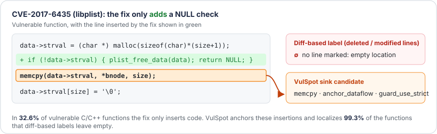

# VulSpot

**A living benchmark for vulnerability _detection_, _CWE classification_, and _statement-level localization_, where no vulnerability goes unlocalized.**

[💻 Code (GitHub)](https://github.com/DynaSoumhaneOuchebara/VulSpot-Dataset) · 📄 Paper: *Beyond the Diff — VulSpot: A Vulnerability Dataset Where No Vulnerability Goes Unlocalized* (under review) · 🏷️ Paper release: [`v2026-10-12`](https://huggingface.co/datasets/ods01/VulSpot/tree/v2026-10-12)

<p align="center">
  
</p>

VulSpot links CVEs from the NVD to their fixing commits and labels every changed function as vulnerable (before the fix) or safe (after it). Existing datasets give a vulnerable function no location when its fix **only adds code**, such as a missing NULL check, `free`, or lock. VulSpot anchors such insertions on the statement of the vulnerable version they protect, and localizes **99.3%** of the functions that diff-based labels leave empty. It also provides:

- a rule-based **confidence tier** for each vulnerable label and a **provenance type** for each negative, instead of a hard filter;
- **clone-aware** chronological and project-holdout splits, plus high-confidence, paired, and non-Linux test subsets;
- a `balanced` variant that caps the post-2024 surge of Linux kernel CVEs;
- deterministic **AST context** (callees, types, macros, globals) and four hierarchical **CWE views**;
- a **monthly** refresh, so each release adds vulnerabilities that no model has seen yet.

## Quick start

```python
from datasets import load_dataset

cpp = load_dataset("ods01/VulSpot", "cpp", split="full", revision="v2026-10-12")   # paper release
multi = load_dataset("ods01/VulSpot", "multi", split="full")                       # latest release
```

```python
import json
from huggingface_hub import hf_hub_download

path = hf_hub_download("ods01/VulSpot", "cpp/full/splits/chrono.json",
                       repo_type="dataset", revision="v2026-10-12")
split = json.load(open(path))     # train, val, test, test_high, test_paired_high, test_no_linux
df = cpp.to_pandas().set_index("idx")
train, test = df.loc[split["train"]], df.loc[split["test"]]
```

## Statistics (release `v2026-10-12`)

| | `cpp` full | `cpp` balanced | `cpp` paired | `multi` full | `multi` balanced | `multi` paired |
|---|---:|---:|---:|---:|---:|---:|
| Functions | 283,361 | 107,977 | 29,782 | 503,332 | 327,759 | 53,198 |
| Vulnerable functions | 15,932 | 5,629 | 14,891 | 28,334 | 18,025 | 26,599 |
| Vulnerable share | 5.6% | 5.2% | 50.0% | 5.6% | 5.5% | 50.0% |
| CVEs | 16,176 | 5,332 | 12,079 | 24,257 | 13,407 | 18,270 |
| Repositories | 753 | 753 | 688 | 3,634 | 3,634 | 3,112 |
| Distinct CWEs | 231 | 217 | 228 | 429 | 420 | 426 |
| Linux share of vulnerable | 75.1% | 29.7% | 74.3% | 42.3% | 9.3% | 41.6% |
| Confidence high / medium / low | 81 / 17 / 3% | 67 / 27 / 7% | 80 / 17 / 3% | 61 / 36 / 3% | 45 / 50 / 5% | 61 / 36 / 3% |
| Additive fixes (of vulnerable) | 32.6% | 32.4% | 33.2% | 25.4% | 21.2% | 26.0% |

The CVEs span 2009 to October 2026. `multi` covers 21 languages: C, C++, PHP, Python, JavaScript, TypeScript, Go, Java, Ruby, Rust, C#, Erlang, Perl, Swift, Kotlin, Objective-C, Scala, Bash, Lua, Dart, and TSX.

## Releases

VulSpot is updated every month. Each release is a tag of this repository named after the last NVD publication day it covers (`v<YYYY-MM-DD>`). Loading without `revision` gives the latest release. **Use `v2026-10-12` to reproduce the paper.** Tags appear in the branch selector of the *Files and versions* tab, and you can list them with:

```python
from huggingface_hub import list_repo_refs
print(sorted(t.name for t in list_repo_refs("ods01/VulSpot", repo_type="dataset").tags))
```

Each release's `version.json` records the window it covers. The code that built each release is tagged with the same name on [GitHub](https://github.com/DynaSoumhaneOuchebara/VulSpot-Dataset).

## Configurations and variants

| Config | Content |
|---|---|
| `cpp` | C/C++ files only (`.c`, `.cc`, `.cpp`, `.h`, `.hpp`, ...) |
| `multi` | All 21 supported languages, with a `language` column |

Each config has three variants, exposed as dataset splits:

- `full`: every function that passed the filters (vulnerable, fixed, untouched, and added by the fix).
- `balanced`: `full`, with the post-2024 Linux kernel CVEs (`is_kernel_cna`) of each calendar year capped at the kernel's average yearly CVE count before 2024. The kept CVEs are a seeded sample spread over the year, so chronological val/test still contain some Linux.
- `paired`: vulnerable functions whose fixed version is also in `full`, plus those fixed rows. `idx` and `fixed_func_idx` keep their `full` values, so the fixed version of a function is the row with `idx == fixed_func_idx`.

## Splits

Two index files sit next to each variant's Parquet file. They list values of the `idx` column.

- `splits/chrono.json`: commits are sorted by the earliest publication date of their CVEs and cut 80/10/10 (by rows) into train/val/test. All rows of a commit stay together. Then the clone rule applies: a row whose `clone_group_id` already appears in an earlier split (train < val < test) is excluded. As a result, no test function is a near-duplicate of a training function, and training never contains data newer than test.
- `splits/project_holdout.json`: randomly chosen whole projects, about 10% of the rows, form the test set (`torvalds/linux` always stays in train/val). The rest is split chronologically into train/val. The same clone rule applies.

Both files also contain evaluation subsets of `test`:

- `test_high`: `clean` test rows, without the vulnerable rows whose `label_confidence` is not `high`. All clean negatives are kept.
- `test_paired_high`: high-confidence vulnerable rows whose fixed version is also in test, plus those fixed versions (paired evaluation).
- `test_no_linux`: test without `torvalds/linux` rows.

## Collection

1. **CVEs**: all non-rejected CVEs from the NVD API 2.0, fetched in windows by publication date.
2. **Patch commits**: references tagged `Patch` that point to a GitHub commit, or to `git.kernel.org` (remapped to `torvalds/linux`). A fork is kept only if the SHA exists in the parent repository, and is attributed to the parent.
3. **Commits**: message, unified diff, and before/after file contents. Merge commits, commits with more than 300 files, and files over 2 MB are dropped. Linux stable backports are dropped when a mainline commit covers the same CVE. The remaining multi-commit CVEs are dropped.
4. **Functions**: tree-sitter extraction, before/after pairing by name, signature, and order, and a statement-level edit script.
5. **Labels and filters**: confidence tiers replace a hard filter for tangled commits. Other changed functions in multi-function files, and vulnerable functions in test or fuzzing files, are never labeled vulnerable.

## Label semantics

`is_vulnerable` is the function-level label. `cve_list` and `cwe_list` hold the linked CVEs and their raw NVD CWEs.

### Localization

VulSpot provides two localization layers:

- `changed_lines` / `changed_statements`: diff-based labels. On a vulnerable row, they hold the **deleted and updated** statements. On a fixed row, they hold the **added and updated** ones. They are JSON strings `[[line, text], ...]` with line numbers relative to the start of the file. `edit_actions` stores the full statement edit script: each statement is unchanged, updated, deleted, inserted, or moved. Whitespace-only edits count as unchanged, and comment edits are flagged as non-code (`is_code`).
- `sink_candidates` (vulnerable rows only): a JSON list of the statements a localizer should point at. It contains the deleted and updated statements, plus one **anchor** per group of consecutive inserted statements, taken from the vulnerable version. Each entry has `kind`, `abs_line`, `rel_line`, `byte_start`, `byte_end`, `text`, and, for anchors, `anchor_rule` and `inserted_text`.

| `kind` | `anchor_rule` | Strength | Anchor |
|---|---|---|---|
| `deleted`, `updated` | – | diff | The statement removed or changed by the fix |
| `anchor_dataflow` | `guard_use_strict` | strong | Inserted guard `if (c) return/goto/break/continue;`: the first later use of a variable of `c` |
| `anchor_dataflow` | `release_acquire` | strong | Inserted free/put of X: the statement that assigns X. Inserted unlock of L: the lock of L |
| `anchor_dataflow` | `lock_region` | strong | Inserted lock … unlock pair: the statements it now protects |
| `anchor_dataflow` | `status_def` | strong | Inserted check of a status variable (`if (err) goto out;`): the call that set it |
| `anchor_dataflow` | `init_use` | strong | Inserted reset or zeroing of X: the earlier free that left X dangling, else the next use of X |
| `anchor_dataflow` | `move_early` | strong | Pure reordering, statement moved later: the statement itself, at its old place |
| `anchor_dataflow` | `move_crossed` | strong | Pure reordering, statement moved earlier: the first statement it jumped over that uses what it assigns |
| `anchor_dataflow` | `guard_use_relaxed` | medium | Any other inserted `if (c)`: the first later use of a variable of `c` |
| `anchor_dataflow` | `jump_enclosing` | medium | Inserted bare `return`/`goto`/`break`: the condition it now exits on |
| `anchor_dataflow` | `shared_ident` | weak | The nearest statement sharing the rarest identifiers with the inserted code |
| `anchor_next` / `anchor_prev` | – | positional | No shared identifier: the next statement, or the previous one at the end of the function |

You can train on diff-only targets (`deleted`, `updated`), add the anchors, or keep only the strongest rules. `n_sink_candidates` and `n_code_edits` give per-function counts.

### Label reliability

`label_confidence` (vulnerable rows):

- `high`: the commit changes exactly one function (test files excluded), or the function is named in a linked CVE description.
- `medium`: the only changed function of its file, in a commit that touches several files.
- `low`: one of several changed functions in its file, and named in the commit message.

`neg_type` (safe rows):

- `fixed`: the patched version of a vulnerable function.
- `untouched`: an unchanged function from a file the fix touches (up to 20 per file). It is assumed safe, but may hide unknown vulnerabilities.
- `added_by_fix`: a function introduced by the fix.
- `patched_later_vulnerable`: a `fixed` row that a later CVE commit in the dataset modifies again (`later_fixed_by`).

`label_conflict` marks a body whose exact duplicates carried different labels. This happens, for example, when a fix was reverted or an unfixed function was copied elsewhere. `clean` is true when `label_confidence` is `high`, `medium`, or null (untouched negatives), `label_conflict` is false, `neg_type` is not `patched_later_vulnerable`, and the row is not a vulnerable function whose fix only changed comments. `mentioned_in_cve_desc` and `mentioned_in_commit_msg` give the raw evidence behind the tiers.

`is_kernel_cna` flags CVEs assigned by the kernel.org CNA with `published_date ≥ 2024-02-01`.

### CWE views

Each raw CWE is mapped onto four MITRE views by walking up the CWE hierarchy to the nearest member of the view. The lists keep first-seen order and drop duplicates, unless stated otherwise.

- `cwe_1000_list`: the 10 pillars of CWE-1000 (Research Concepts), following the primary ChildOf link.
- `cwe_1003_list`: the 130 members of CWE-1003 (Simplified Mapping of Vulnerabilities). `cwe_1003_high_list` keeps only its 37 top-level entries.
- `cwe_699_list`: the 40 categories of CWE-699 (Software Development). A weakness listed under several categories maps to all of them.
- `cwe_1400_list`: the categories of CWE-1400 (Software Assurance Trends). It has one entry per CWE in `cwe_list`, in the same order, and null when the CWE is not in the view.
- `top15_cwe_1400`: one entry per CWE in `cwe_list`. The 15 most frequent CWEs of the table's chronological training split stay as they are. Every other CWE is replaced by its `cwe_1400_list` entry. Frequent weaknesses keep their precise class, and the long tail is grouped instead of dropped.

A CWE with no path to the view is dropped (or null in the per-position columns). This mostly affects deprecated NVD categories (`NVD-CWE-Other`, `NVD-CWE-noinfo`).

### Context

These columns are extracted deterministically from the AST and the source file, without LLMs:

- `callees`
- `same_file_callee_defs` (name, lines, and code of the callees defined in the same file)
- `types_used`
- `macros_used`
- `globals_used`

### Deduplication

- `hash`: the MD5 of the body, with each line stripped. Exact duplicates are removed, and the earliest occurrence by CVE publication date is kept.
- `norm_hash`: the same, ignoring comments and whitespace.
- `clone_group_id`: near-duplicate groups found with MinHash-LSH (5-token shingles, Jaccard ≥ 0.8).

### Other columns

| Group | Columns |
|---|---|
| Source | `project`, `project_url`, `commit_id`, `parent_commit_id`, `filepath`, `func_name`, `func_signature`, `qualified_name`, `language` |
| Code | `func_body`, `func_start_line`, `func_end_line`, `func_byte_range`, `n_lines`, `n_statements` |
| Pairing | `fixed_func_idx`, `pair_id`, `pair_status` (`paired`, `renamed`, `removed`, `added`, `untouched`) |
| CVE metadata | `cve_descriptions`, `cvss`, `cvss_base_score`, `cvss_severity`, `published_date`, `cna` |
| Commit metadata | `commit_message` (trailers removed), `commit_message_raw`, `commit_date`, `commit_n_files`, `commit_n_funcs`, `file_n_changed_funcs`, `is_test_file` |

## Limitations

- Confidence tiers quantify and reduce label noise, but do not remove it. A single-function commit can be a partial fix, and untouched negatives may hide unknown vulnerabilities.
- Anchors follow data flow only through shared identifiers.
- Only CVEs fixed by a single commit linked from NVD with a `Patch` tag on GitHub or `git.kernel.org` are included. CWE labels are taken from NVD as is.

## Licensing

The function bodies are reproduced **verbatim** from open-source repositories for research purposes. Each row points back to its source through `project_url` and `commit_id`. The code remains under the license of its original project. **This dataset does not grant or claim a single license covering the code.**

## Citation

```bibtex
@inproceedings{ouchebara2027vulspot,
  title     = {Beyond the Diff -- {VulSpot}: A Vulnerability Dataset Where No Vulnerability Goes Unlocalized},
  author    = {Ouchebara, Dyna Soumhane and Dupont, St{\'e}phane},
  year      = {2027},
  note      = {Under review}
}
```
